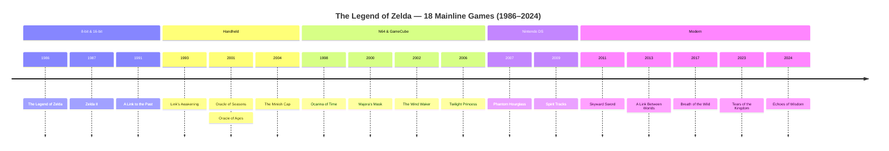
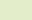
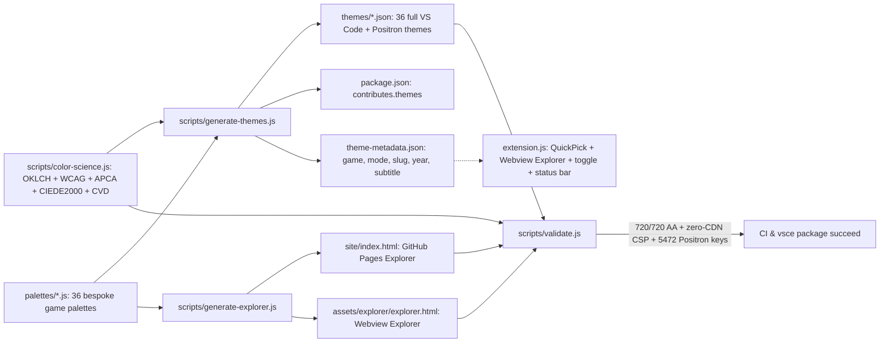
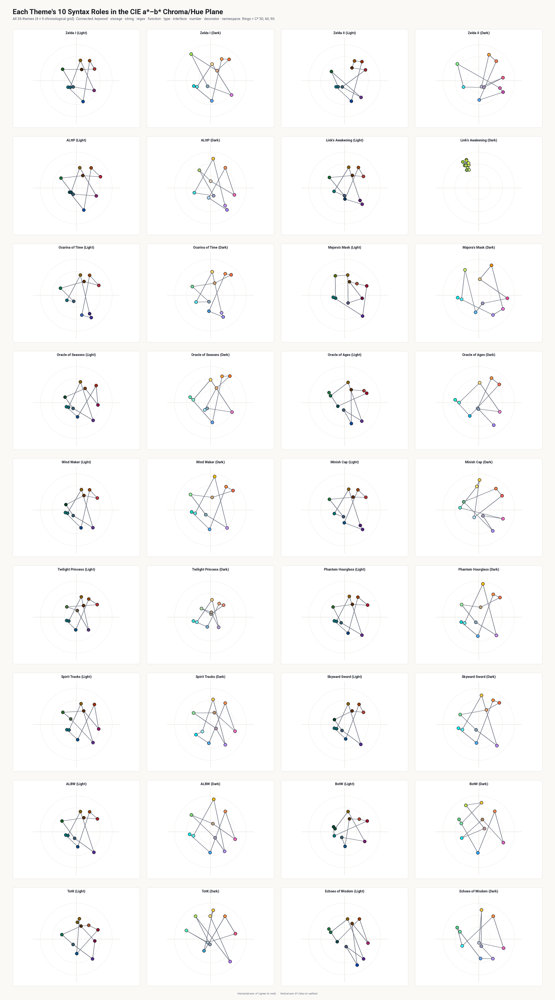
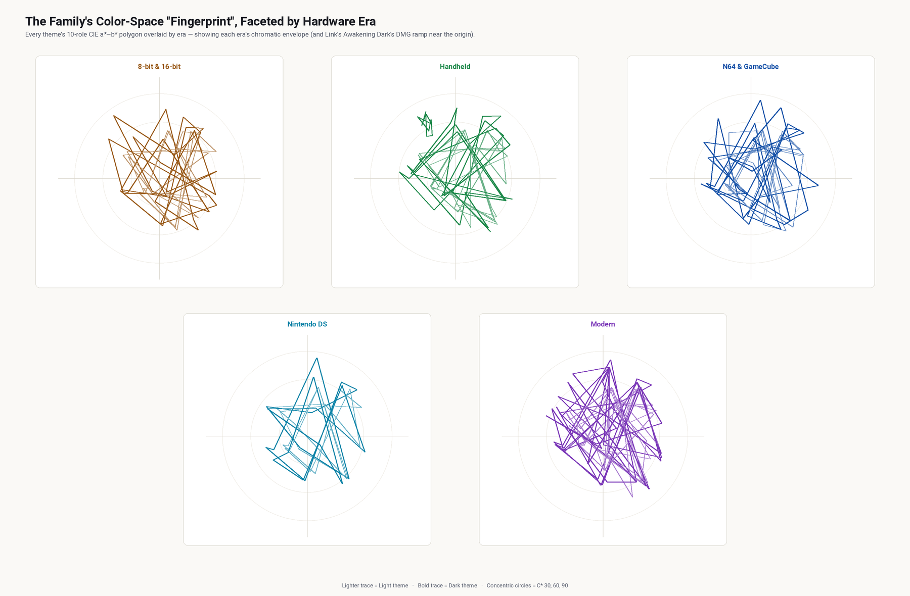
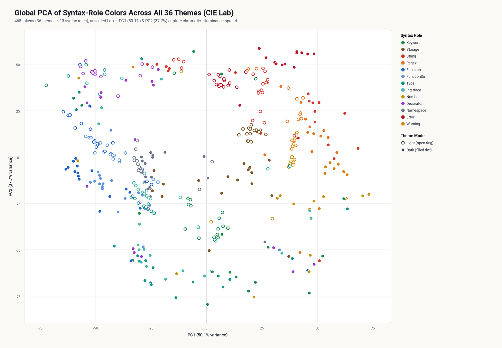
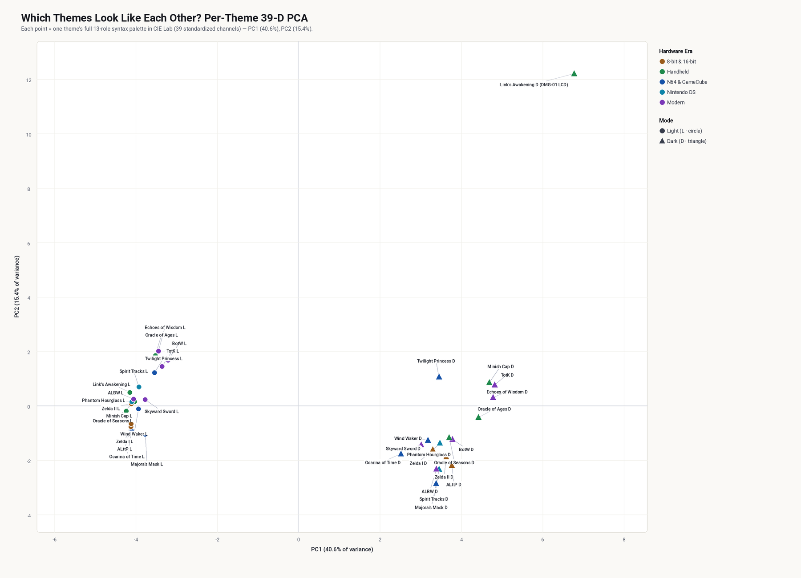
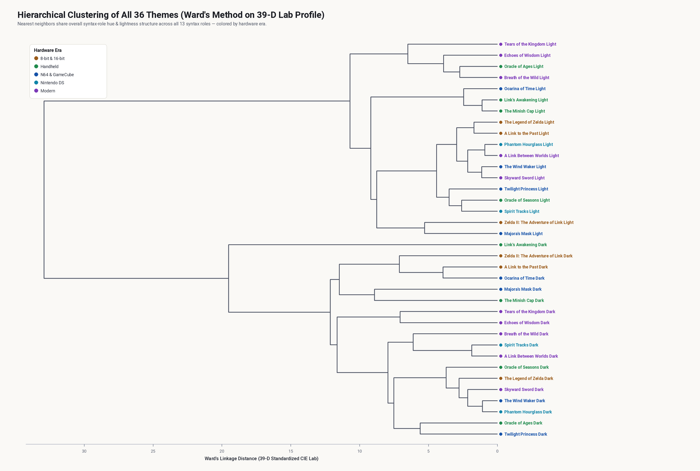
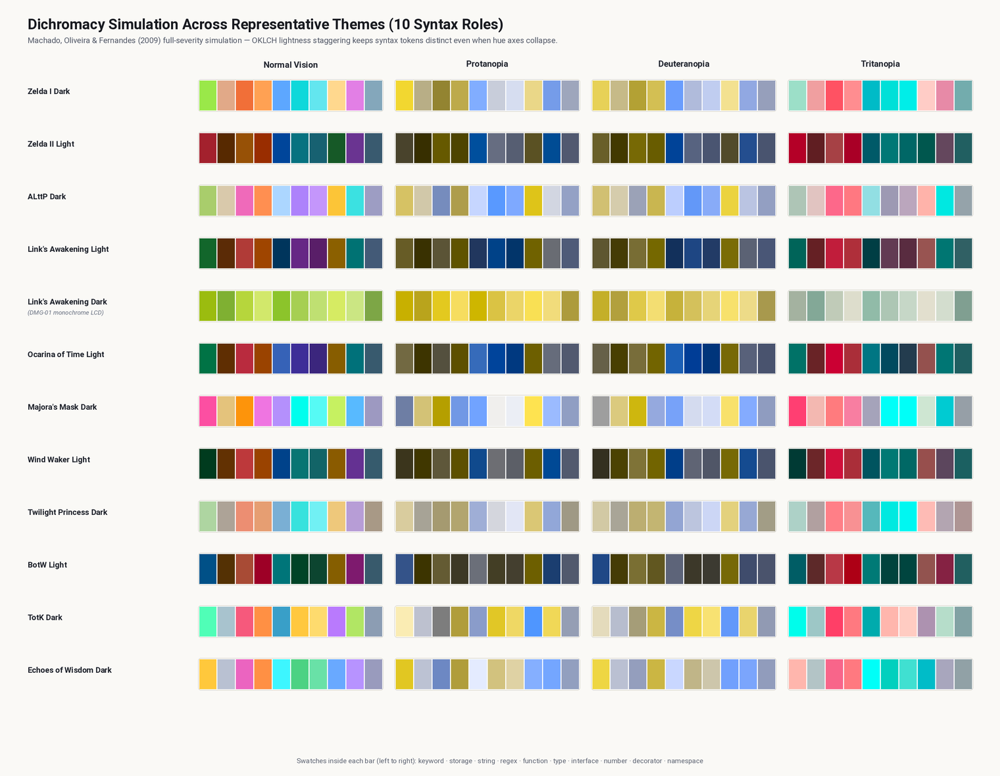

<!-- markdownlint-disable MD033 MD041 -->
```text
       /\
      /  \
     /    \
    /------\
   /\      /\
  /  \    /  \
 /    \  /    \
/------\/------\
```

<div align="center">

# Hylian Palette

**A Light and Dark color theme for every mainline Legend of Zelda game.**
18 games · 36 themes · one VS Code / Positron extension.

[](https://karlmakepeace.github.io/positron-hylian-palette/)
[](https://github.com/karlmakepeace/positron-hylian-palette/actions/workflows/build.yml)


-2A5F25?style=flat-square)


**[Launch the Live Interactive Workbench & Colorimetry Explorer ↗](https://karlmakepeace.github.io/positron-hylian-palette/)**
*(Or run **`Hylian Palette: Open Palette & Colorimetry Explorer`** directly inside VS Code / Positron!)*

</div>

---

Every pair in **Hylian Palette** is individually authored from its game's actual art direction and display hardware — never a generic syntax template reskinned onto a new background:

- **Ocarina of Time** maps syntax roles directly to the three Spiritual Stones (Kokiri Emerald, Goron Ruby, Zora Sapphire) and the royal periwinkle-indigo Ocarina itself, anchored by unchanging `#C9A227` Triforce gold.
- **Zelda II**, **Majora's Mask**, **Breath of the Wild**, **Oracle of Ages**, and **Echoes of Wisdom** deliberately break out of traditional "green keyword" conventions when the game's visual identity calls for Palace brick-crimson, Carnival plum-magenta, Sheikah Slate cyan-blue, Nayru's Harp of Ages sapphire, or Zelda's royal traveling cloak and Tri Rod gold.
- **Twilight Princess Dark** desaturates its entire Twilight Realm syntax envelope into muted sage, dusk slate, and glowing cyan runes so Midna's `#FF781F` flame-orange cursor stands out exactly as she does on screen.
- **Link's Awakening Dark** honors the 1993 DMG-01 Game Boy's iconic 4-shade olive-green reflective LCD (`#0F380F`–`#9BBC0F`) with a perceptually monotonic OKLCH lightness ramp that still clears WCAG AA across every role.

Every palette is synthesized and verified in **OKLCH** perceptual color space against **WCAG 2.1**, **APCA-W3**, **CIEDE2000** ($\Delta E_{00}$), and **Machado et al. (2009)** dichromacy simulation. Design inspiration comes strictly from **color language and atmosphere** — no game artwork, logos, sprites, or copyrighted assets are included or referenced anywhere in this repository.

Named "Hylian" rather than "Hyrule" on purpose: several of these games aren't set in Hyrule at all (Termina, Koholint, Holodrum, Labrynna, the Great Sea, Lorule, the Still World). "Hylian" — the heritage, shield crest, and script that thread through every era — is the one name that spans the whole series.

## The 18 games, by release date



## ...and by in-universe story chronology

This is the other timeline — the one every Zelda fan actually means by "the timeline." Per Nintendo's official chronology, the story splits into three branches after *Ocarina of Time* (Child, Adult, and Downfall — including *Echoes of Wisdom* between *Tri Force Heroes* and the Era of Decline's original *The Legend of Zelda* and *Zelda II*) before reconverging in the distant future with *Breath of the Wild* and *Tears of the Kingdom*. Rendered from scratch in this project's own style and colors:


```sh
Rscript --vanilla analysis/timeline_metro.R  # or: python3 scripts/generate-color-science-assets.py
```

## Every pair tells a story

Four examples of how a Light/Dark pair is built — anchored to each game's specific world, lighting, and signature identity color while maintaining perceptual contrast and OKLCH lightness separation:

### Ocarina of Time (1998) — the three Spiritual Stones & the royal-blue Ocarina

| Role | Light | Dark |
|---|---|---|
| Background |  `#EDE9D6` sunlit Temple of Time limestone |  `#070E1D` midnight Hyrule Field & Water Temple |
| Keywords |  `#007345` Kokiri **Emerald** |  `#6BD798` Kokiri Emerald lit by dungeon torchlight |
| Strings |  `#B92B3E` Goron **Ruby** |  `#FA6C3F` volcanic Death Mountain ruby-ember |
| Functions |  `#3662B7` Zora **Sapphire** |  `#4492D2` luminous Zora Sapphire |
| Types |  `#3D2E98` the royal periwinkle-indigo Ocarina |  `#9E8EFF` glowing Ocarina & Nocturne of Shadow |
| **Identity accent** |  `#C9A227` **Triforce gold** (cursor & focus) |  `#C9A227` byte-for-byte identical Triforce gold |

### The Wind Waker (2002) — cel-shaded Great Sea by day and by starlight

| Role | Light | Dark |
|---|---|---|
| Background |  `#F7ECD6` sun-bleached sea-chart parchment |  `#001018` abyssal midnight ocean |
| Keywords |  `#003B1E` Outset Island Hero's tunic green |  `#8FF794` Wind's Requiem seafoam-emerald |
| Strings |  `#BD393B` King of Red Lions' hull & crest |  `#FF6645` lantern-lit vermilion hull |
| Functions |  `#00428A` crisp cel-shaded Great Sea ultramarine |  `#4CABFD` moonlit cresting wave blue |
| Types |  `#087573` Wind Waker baton lagoon teal |  `#00DACB` bioluminescent Great Sea turquoise |
| **Identity accent** |  `#D62828` **King of Red Lions crimson** |  `#FA5247` luminous crimson beacon |

### Majora's Mask (2000) — Carnival of Time fever-dream & Termina's Final Night

| Role | Light | Dark |
|---|---|---|
| Background |  `#F9E6DA` Dawn of the Final Day peach-parchment |  `#10071B` Clock Tower midnight violet void |
| Keywords |  `#64003D` Majora's Mask plum-magenta |  `#FC4FA2` neon Majora magenta |
| Strings |  `#9E4F37` Termina sunset & Deku copper-orange |  `#FD940B` blazing falling-Moon amber |
| Functions |  `#562694` Woodfall & Skull Kid royal violet |  `#B490FC` astral Woodfall lavender-purple |
| Types |  `#00736E` Fierce Deity & Great Bay deep teal |  `#00FEED` electric Fierce Deity cyan |
| **Identity accent** |  `#BD195D` **Majora magenta** cursor |  `#1CEAD4` **Fierce Deity cyan** cursor & focus |

### Echoes of Wisdom (2024) — toybox diorama Hyrule & the Still World rift

| Role | Light | Dark |
|---|---|---|
| Background |  `#F5EEDE` sunlit tilt-shift Castle Town craft stone |  `#0F091F` fractured Still World indigo-violet rift |
| Keywords |  `#003CAF` Princess Zelda's royal indigo cloak |  `#FFC83C` **Tri's golden triangles** & Tri Rod glow |
| Strings |  `#A9226E` encroaching Null rift magenta |  `#EB64C0` luminous Still World rift magenta-rose |
| Functions |  `#004648` Zora Cove & Bind-tether deep teal |  `#3DF6FF` Swordfighter-form energy cyan |
| Types |  `#24793E` Faron Wetlands & toybox meadow green |  `#4CD283` suspended Still World canopy emerald |
| **Identity accent** |  `#C98A08` **Tri Rod gold** cursor |  `#FFD147` radiant Tri golden trail |

## The full catalog

<details>
<summary><strong>All 36 themes across 18 mainline games, era by era — click to expand</strong></summary>

Each swatch strip reads left to right: **background · keywords · strings · functions · types**. Every single theme has unique primary hexes — zero copy-pasted syntax templates across games.

<!-- CATALOG:START -->

**8-bit & 16-bit Classics**

| Game | Light (bg · keyword · string · function · type) | Dark (bg · keyword · string · function · type) |
|---|---|---|
| **The Legend of Zelda** (1986) |      |      |
| **Zelda II: The Adventure of Link** (1987) |      |      |
| **A Link to the Past** (1991) |      |      |

**Handheld (Game Boy / Color / Advance)**

| Game | Light (bg · keyword · string · function · type) | Dark (bg · keyword · string · function · type) |
|---|---|---|
| **Link's Awakening** (1993) |      |      |
| **Oracle of Seasons** (2001) |      |      |
| **Oracle of Ages** (2001) |      |      |
| **The Minish Cap** (2004) |      |      |

**N64 & GameCube**

| Game | Light (bg · keyword · string · function · type) | Dark (bg · keyword · string · function · type) |
|---|---|---|
| **Ocarina of Time** (1998) |      |      |
| **Majora's Mask** (2000) |      |      |
| **The Wind Waker** (2002) |      |      |
| **Twilight Princess** (2006) |      |      |

**Nintendo DS**

| Game | Light (bg · keyword · string · function · type) | Dark (bg · keyword · string · function · type) |
|---|---|---|
| **Phantom Hourglass** (2007) |      |      |
| **Spirit Tracks** (2009) |      |      |

**Modern (Wii / 3DS / Switch)**

| Game | Light (bg · keyword · string · function · type) | Dark (bg · keyword · string · function · type) |
|---|---|---|
| **Skyward Sword** (2011) |      |      |
| **A Link Between Worlds** (2013) |      |      |
| **Breath of the Wild** (2017) |      |      |
| **Tears of the Kingdom** (2023) |      |      |
| **Echoes of Wisdom** (2024) |      |      |

<!-- CATALOG:END -->

*(Swatch PNGs are generated locally by `scripts/generate-swatches.js` — no third-party badge service, no network dependency for viewers, nothing to go stale.)*

</details>

## Installing from the Marketplace or Open VSX

Search for **Hylian Palette** in the Extensions view (`Ctrl+Shift+X` / `Cmd+Shift+X`) in VS Code, Positron, or any VS Code-compatible editor, or install from the command line:

```sh
code --install-extension karlmakepeace.positron-hylian-palette
# or in Positron:
positron --install-extension karlmakepeace.positron-hylian-palette
```

## Packaging & installing locally

From this repository root:

```sh
npx --yes @vscode/vsce package
positron --install-extension positron-hylian-palette-1.0.0.vsix
```

Or launch an Extension Development Host without packaging:

```sh
positron --extensionDevelopmentPath="<full path to this folder>"
```

## Selecting & previewing themes

- **Hylian Palette: Open Palette & Colorimetry Explorer** (Command Palette or Welcome walkthrough): opens a 100% offline interactive workbench & colorimetry studio directly inside VS Code / Positron — preview R, Python, TypeScript, and Quarto/SQL buffers across all 36 themes, inspect live OKLCH / WCAG 2.1 / APCA readouts and OKLab chromaticity polygons, simulate Protanopia / Deuteranopia / Tritanopia in real time, and click **Apply to Workbench** (or toggle **Live-sync IDE**) to switch your editor theme on the fly. The exact same explorer is also hosted on the web via **[GitHub Pages](https://karlmakepeace.github.io/positron-hylian-palette/)**.
- **Hylian Palette: Pick Zelda Theme** (Command Palette or click the active theme badge in the bottom-right status bar): opens a release-ordered quick-pick grouped by all 18 games with **live theme preview** as you arrow up/down, subtitle lore notes on every entry, an `Active` indicator on your current theme, and clean `Esc` rollback if you cancel.
- **Preferences: Color Theme** (`Ctrl+K Ctrl+T` / `Cmd+K Cmd+T`): standard alphabetical VS Code / Positron picker across all 36 themes.
- **Hylian Palette: Random Theme**: jumps to a random theme across the other 35 themes — great for touring the catalog.
- **Welcome: Open Walkthrough** → **Welcome to Hylian Palette**: interactive first-run walkthrough covering theme picking, per-game Light/Dark toggling, identity accents, and launching the interactive Explorer.

## Smart Light ↔ Dark per-game toggle

Run **Hylian Palette: Toggle Theme** from the Command Palette or press `Ctrl+K Ctrl+Z` (`Cmd+K Cmd+Z` on macOS). Unlike a generic light/dark switch, it flips between the Light and Dark variant of **whichever game you're currently using** (e.g. *Echoes of Wisdom Light* ↔ *Echoes of Wisdom Dark*, *Ocarina of Time Light* ↔ *Ocarina of Time Dark*). If a non-Hylian theme is active, it starts on *The Wind Waker Light*. Only the standard `workbench.colorTheme` User setting is read or written.

## How the themes are built



Hand-authoring ~350 workbench, TextMate, semantic-token, and Positron IDE keys across 36 themes doesn't scale by hand, so `scripts/generate-themes.js` expands each game's ~45-token story palette (`palettes/*.js`) using OKLCH perceptual mixing, `scripts/generate-explorer.js` compiles the self-contained GitHub Pages (`site/index.html`) and VS Code Webview (`assets/explorer/explorer.html`) interactive explorers from those same modules, and `scripts/validate.js` enforces multi-gate colorimetric and zero-CDN CSP verification on every build:

```sh
node scripts/generate-themes.js    # regenerate themes/*.json + package.json + theme-metadata.json
node scripts/generate-explorer.js  # regenerate site/index.html + assets/explorer/explorer.html
node scripts/generate-swatches.js  # regenerate 345 local swatch PNGs in assets/swatches/
node scripts/validate.js           # audit all 36 themes, Explorer CSP & Positron key provenance
```

## Accessibility & perceptual contrast

Every single theme must clear strict automated perceptual gates before `generate-themes.js` or `validate.js` will succeed:

- **100% WCAG 2.1 AA compliance (`720 / 720` foreground & syntax tokens)**: all 20 foreground/syntax tokens in all 36 themes clear **$\ge$ 4.5:1** on `editor.background` (actual range across the family: **`4.62:1` to `14.36:1`**) and **$\ge$ 3.8:1** on `editor.lineHighlightBackground`.
- **APCA-W3 spatial contrast**: primary body text (`fg` on `bg`) achieves **`|Lc| = 79.4` to `93.7`** (`12.68:1`–`14.36:1` WCAG) across all 35 polychromatic themes, tuned to prevent halation on dark OLED displays while keeping warm paper-like light themes crisp and glare-free.
- **Figure–ground hierarchy**: comments (`fgComment`) clear AA comfortably (`4.77:1`–`6.05:1`) while remaining perceptually subordinate to active code tokens so documentation never competes with control flow.
- **576 / 576 ANSI terminal tokens verified**: all 16 ANSI colors in every integrated terminal / Positron console clear contrast gates while preserving canonical terminal hue bands (so red errors stay red and green diffs stay green even when a theme's syntax keywords are gold or indigo).

| Representative Theme | Editor `fg` / `bg` (WCAG) | Editor `fg` / `bg` (`|Lc|` APCA) | Comment / `bg` | Tightest foreground/syntax role / `bg` |
|---|---|---|---|---|
| **Echoes of Wisdom Light** | `14.36:1` | `93.7` | `5.90:1` | `4.68:1` |
| **The Wind Waker Light** | `13.96:1` | `92.5` | `5.95:1` | `4.70:1` |
| **Tears of the Kingdom Dark** | `13.33:1` | `80.9` | `5.89:1` | `4.64:1` |
| **Majora's Mask Dark** | `13.21:1` | `80.0` | `5.89:1` | `5.05:1` |
| **Twilight Princess Dark** *(muted Twilight Realm)* | `12.79:1` | `79.8` | `5.94:1` | `4.70:1` |
| **Link's Awakening Dark** *(1993 DMG-01 LCD ramp)* | `8.74:1` | `74.2` | `4.77:1` | `4.66:1` |

## Color science

Every theme's 13 adjacent syntax-relevant roles (`keyword`, `storage`, `string`, `regex`, `function`, `function-dim`, `type`, `interface`, `number`, `decorator`, `namespace`, `error`, `warning` — **468 syntax tokens** across 36 themes) are synthesized in Björn Ottosson's **OKLCH** perceptual color space and audited in **CIE 1976 $L^*a^*b^*$** (`CIEDE2000` $\Delta E_{00}$ for normal-vision categorical distinctness and **Machado, Oliveira & Fernandes (2009)** physiological cone-matrix simulation for protanopia, deuteranopia, and tritanopia).



Plotting each theme's 10 core syntax roles in the CIE $a^*$–$b^*$ chromaticity plane and connecting them in fixed role order reveals each game's chromatic "signature" at a glance: *Link's Awakening Dark* collapses into a tight olive-chartreuse needle near a single hue angle (authentic DMG-01 LCD), *Twilight Princess Dark* forms a restrained atmospheric envelope, and high-chroma worlds like *Majora's Mask Dark*, *Tears of the Kingdom Dark*, and *Echoes of Wisdom Dark* span wide, balanced polygons across all four quadrants.





An unscaled global PCA across all **468 syntax tokens** (`PC1 = 50.1%`, `PC2 = 37.7%`, explaining **87.8%** of total perceptual variance in 2D) shows how semantic roles occupy structured, well-separated regions while intentionally allowing game-driven cross-hue expressive freedom where lore demands it.

### Which themes look like each other

Converting each theme's 13 syntax roles into a **39-dimensional CIE $L^*a^*b^*$ feature vector** (`analysis/theme_similarity.R`) lets us compare entire themes side-by-side via standardized PCA (`PC1 = 40.6%`, `PC2 = 15.4%`) and **Ward's minimum-variance hierarchical clustering**:





Three empirical patterns emerge directly from the geometry without any manual grouping:

1. **Clean polarity separation + hardware-monochrome isolation**: Light and Dark themes separate cleanly along `PC1`, while **Link's Awakening Dark** branches off first from the entire Dark supercluster at Ward linkage distance `~19.5` (and sits isolated in the upper-right of `PC1`–`PC2`), quantitatively confirming its unique 1993 DMG-01 LCD profile.
2. **Art-direction subclusters within Light mode**: the three Light themes that replace traditional green keywords with royal/slate blue — **Echoes of Wisdom Light** (Zelda's indigo cloak), **Oracle of Ages Light** (Nayru's Harp of Ages), and **Breath of the Wild Light** (Sheikah Slate blue) — form their own cohesive branch, while **Zelda II Light** (Palace brick-crimson) and **Majora's Mask Light** (Carnival plum-magenta) pair directly together as the warm-crimson/magenta outliers.
3. **Direct lore sequels cluster as nearest neighbors**: **The Wind Waker Dark** + **Phantom Hourglass Dark** (cel-shaded nocturnal Great Sea sequels), **The Legend of Zelda Light** + **A Link to the Past Light**, and **Tears of the Kingdom Dark** + **Echoes of Wisdom Dark** (modern Switch subterranean/void dark worlds lit by gold, emerald, and cyan beacons) pair up naturally from color data alone.

### Color-vision-deficiency (CVD) resilience via OKLCH lightness staggering

Categorical syntax palettes that rely purely on hue (such as an isoluminant red string next to a green keyword) collapse under protanopia or deuteranopia. To prevent this scientifically, every Hylian Palette staggers adjacent syntax roles across **OKLCH perceptual lightness ($L$)** as well as hue — because luminance contrast survives all three cone deficiencies even when chromatic axes collapse.



Across all **2,808 role-pairs** (`36 themes × 78 pairs`) and **756 critical adjacent syntax pairs** (`keyword`, `storage`, `string`, `function`, `type`, `number`, `error`):

- **35 polychromatic themes (`735` critical pairs)**: **0 severe collisions** (`< 5 ΔE*ab`) and **0 moderate collisions** (`< 10 ΔE*ab`) under simulated protanopia, deuteranopia, or tritanopia. Every critical syntax pair stays $\ge 10\,\Delta E^*_{ab}$ apart across all three CVD simulations.
- **Link's Awakening Dark (monochrome hardware tribute)**: accounts for the only **3** critical pairs below `10 ΔE*ab` in the entire 36-theme family (`accentStorage`/`colorError` at `2.04`, `accentKeyword`/`accentType` at `7.63`, and `accentKeyword`/`accentStorage` at `9.67`), preserved intentionally as a documented, faithful tribute to the 1993 Game Boy's single-hue olive LCD ramp while still clearing WCAG AA (`4.66:1`–`8.74:1`) on every token.

```sh
node scripts/export-color-data.js                  # export 540 token rows (Lab + OKLCH + WCAG + APCA) to analysis/data/colors.csv
python3 scripts/generate-color-science-assets.py   # regenerate all high-DPI PNG plots + audit CSVs
# Pure-R analytical scripts are also included:
Rscript --vanilla analysis/color_science.R
Rscript --vanilla analysis/theme_similarity.R
Rscript --vanilla analysis/timeline_metro.R
```

## Notes

- Zero runtime `npm` dependencies — `extension.js` uses only the built-in `vscode` API and static `theme-metadata.json`.
- Positron-specific workbench tokens (`positronConsole.*`, `positronVariables.*`, `positronPlots.*`, `positronDataExplorer.*`, etc.) are strictly validated against Positron's upstream color registry (`5,472` verified usages across 36 themes).
- No game artwork, logos, sprites, or copyrighted assets appear anywhere in this repository — every visual (extension icon, 345 swatch PNGs, timeline diagram, and color-science plots) is generated algorithmically from hex coordinates and geometric primitives.

## License

MIT — see [LICENSE](LICENSE).
