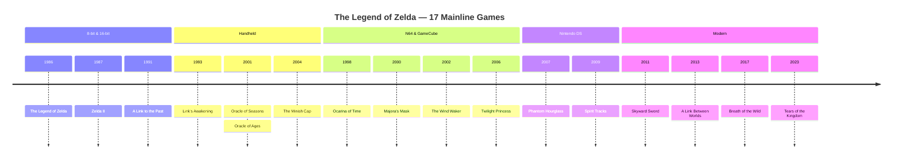
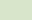
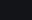
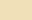
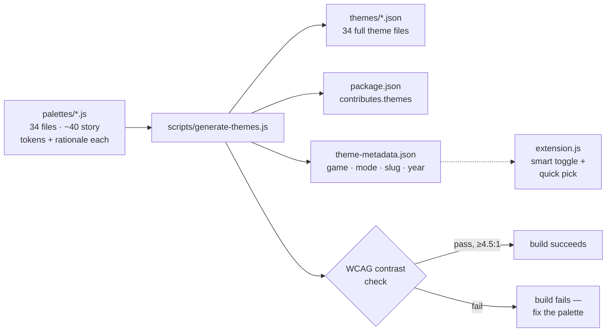

<!-- markdownlint-disable MD033 MD041 -->
<div align="center">

```text
              /\
             /  \
            /    \
           /      \
          /--------\
         /\        /\
        /  \      /  \
       /    \    /    \
      /------\  /------\
```

# Hylian Palette

**A Light and Dark color theme for every mainline Legend of Zelda game.**
17 games · 34 themes · one VS Code / Positron extension.


</div>

---

Each pair has its own rationale-backed palette drawn from that game's actual art direction, not a generic reskin: Ocarina of Time's syntax colors *are* the three Spiritual Stones, Twilight Princess Dark deliberately desaturates everything except Midna's orange (matching what the game itself does), Link's Awakening Dark uses the real 4-shade Game Boy green ramp. Design inspiration comes entirely from **color language and atmosphere** — no game artwork, logos, or copyrighted assets are included or referenced anywhere in this repo.

Named "Hylian" rather than "Hyrule" on purpose: several of these games aren't set in Hyrule at all (Termina, Koholint, Lorule). "Hylian" — Link's own heritage, his shield's crest, the invented script that shows up even in those other worlds — is the one thread that runs through the whole series.

## The 17 games, in order



## Every pair tells a story

Three examples of how a Light/Dark pair is built — one signature "identity" color kept constant across both variants, everything else shifting with the light:

### Ocarina of Time — the three Spiritual Stones

|  | Light | Dark |
|---|---|---|
| Background |  `#DEDCC6` carved Temple of Time sandstone |  `#0A0E1C` midnight Hyrule Field |
| Keywords |  `#1B7A4D` Kokiri **Emerald** |  `#3DBE82` brightened for dungeon torchlight |
| Strings |  `#B5231A` Goron **Ruby** |  `#E8534A` glows like lava at night |
| Functions |  `#0F5E9C` Zora **Sapphire** |  `#4FA8E8` glowing sapphire blue |
| Types |  `#1E7A6E` the Ocarina's own teal |  `#3ECBB8` brightened |
| **Identity accent** |  `#C9A227` **Triforce gold** |  `#C9A227` same gold, unchanged |

### The Wind Waker — the Great Sea by day and by night

|  | Light | Dark |
|---|---|---|
| Background |  `#F4EAD4` warm parchment sea-chart |  `#06121C` night ocean |
| Keywords |  `#2A5F25` Hero's green tunic |  `#4FB050` glows under starlight |
| Strings |  `#9E1B1B` King of Red Lions' crimson sail |  `#E8433A` brightened against the dark |
| Functions |  `#023E8A` ocean blue |  `#3D8FE8` glowing ocean blue |
| Types |  `#00695C` Great Sea teal |  `#2AD9C2` vivid glowing turquoise — the box-art color |
| **Identity accent** |  `#D62828` **King of Red Lions crimson** |  `#E8433A` same crimson, brightened |

### Majora's Mask — dread by night, and dread by day

|  | Light | Dark |
|---|---|---|
| Background |  `#F2E4D8` Carnival of Time dawn |  `#0D0714` cosmic void |
| Keywords |  `#C22368` Majora magenta, deepened |  `#FF4D8D` Majora magenta |
| Strings |  `#C2650F` dawn-of-the-final-day orange |  `#FFB347` Termina/Moon orange |
| Functions |  `#7A3EA8` Woodfall purple, deepened |  `#B47EE5` Woodfall purple |
| Types |  `#0A8A78` Fierce Deity cyan, deepened |  `#00F5D4` Fierce Deity cyan |
| **Identity accent** |  `#C22368` **Majora magenta** doubles as cursor |  `#00F5D4` **Fierce Deity cyan** doubles as cursor |

*(The mask's menace doesn't go away just because the sun is out — so unlike the other two pairs, Majora's Mask keeps its keyword color as the identity accent in Light mode, rather than a separate "focus" color.)*

## The full catalog

<details>
<summary><strong>All 34 themes, era by era — click to expand</strong></summary>

Each swatch strip reads left to right: **background · keywords · strings · functions · types**.

<!-- CATALOG:START -->

**8-bit & 16-bit Classics**

| Game | Light (bg · keyword · string · function · type) | Dark (bg · keyword · string · function · type) |
|---|---|---|
| **The Legend of Zelda** (1986) |      |      |
| **Zelda II: The Adventure of Link** (1987) |      |      |
| **A Link to the Past** (1991) |      |      |

**Handheld (Game Boy / Color / Advance)**

| Game | Light (bg · keyword · string · function · type) | Dark (bg · keyword · string · function · type) |
|---|---|---|
| **Link's Awakening** (1993) |      |      |
| **Oracle of Seasons** (2001) |      |      |
| **Oracle of Ages** (2001) |      |      |
| **The Minish Cap** (2004) |      |      |

**N64 & GameCube**

| Game | Light (bg · keyword · string · function · type) | Dark (bg · keyword · string · function · type) |
|---|---|---|
| **Ocarina of Time** (1998) |      |      |
| **Majora's Mask** (2000) |      |      |
| **The Wind Waker** (2002) |      |      |
| **Twilight Princess** (2006) |      |      |

**Nintendo DS**

| Game | Light (bg · keyword · string · function · type) | Dark (bg · keyword · string · function · type) |
|---|---|---|
| **Phantom Hourglass** (2007) |      |      |
| **Spirit Tracks** (2009) |      |      |

**Modern (Wii / 3DS / Switch)**

| Game | Light (bg · keyword · string · function · type) | Dark (bg · keyword · string · function · type) |
|---|---|---|
| **Skyward Sword** (2011) |      |      |
| **A Link Between Worlds** (2013) |      |      |
| **Breath of the Wild** (2017) |      |      |
| **Tears of the Kingdom** (2023) |      |      |

<!-- CATALOG:END -->

*(Swatch PNGs are generated locally by `scripts/generate-swatches.js` — no third-party badge service, no network dependency for viewers, nothing to go stale.)*

</details>

## Installing locally in Positron

From this folder:

```sh
npx --yes @vscode/vsce package
positron --install-extension positron-hylian-palette-0.2.0.vsix
```

Or, for iterating without repackaging each time, launch an Extension Development Host:

```sh
positron --extensionDevelopmentPath="<full path to this folder>"
```

## Selecting a theme

Two ways:

- Open the Command Palette (`Ctrl+Shift+P` / `Cmd+Shift+P`) → **Preferences: Color Theme** → pick any of the 34 themes (alphabetical, VS Code's standard picker).
- Or run **Hylian Palette: Pick Zelda Theme** — a quick-pick grouped by game in release order, showing Light/Dark side by side per game.

## Toggling between Light and Dark

Run **Hylian Palette: Toggle Theme** from the Command Palette. It's a *smart, per-game* toggle: it flips between the Light and Dark variant of whichever game's theme is currently active (e.g. "Ocarina of Time Light" → "Ocarina of Time Dark"). If some other, unrelated theme is active, it defaults to Wind Waker Light. Only the standard `workbench.colorTheme` User setting is read or written — no other settings are touched.

## How the themes are built



Hand-authoring ~300 color keys × 34 themes doesn't scale, so `scripts/generate-themes.js` (a dev-only build tool, not shipped as a runtime dependency) expands a compact ~40-token "story palette" per game/mode — defined in `palettes/*.js`, each with inline rationale comments — into the full theme JSON, and runs an automated contrast check across all of them. See the comment header in any `palettes/*.js` file for that game's specific design story.

```sh
node scripts/generate-themes.js    # regenerate themes/*.json + package.json + theme-metadata.json
node scripts/generate-swatches.js  # regenerate assets/swatches/*.png for this README
```

## Accessibility

Every theme is checked automatically (WCAG 2.1 relative-luminance formula) before it's allowed to build: editor text, comments, and sidebar text must all clear **4.5:1** contrast against their background. Most clear it by a wide margin — editor-text ratios across the family run roughly 6:1 to 15:1. A few notable ones:

| Theme | Editor text / bg | Comment / bg |
|---|---|---|
| Tears of the Kingdom Dark | 15.36:1 | 9.01:1 |
| Wind Waker Dark | 14.59:1 | 5.64:1 |
| Link's Awakening Dark *(the near-monochrome DMG-green theme)* | 6.02:1 | 5.03:1 — the tightest margin in the family, still comfortably clear |

## Color science

Beyond WCAG contrast, every theme's syntax-relevant colors (the 13 roles that actually sit next to each other in real code: keyword, storage, string, regex, function, function-dim, type, interface, number, decorator, namespace, error, warning) are analyzed in CIE Lab space — `analysis/color_science.R`, a from-scratch pure-R implementation (standard sRGB→Lab conversion and the published Machado/Oliveira/Fernandes (2009) color-vision-deficiency model, the same one `colorspace`'s CVD functions are based on — hand-implemented after `colorspace`/`farver` proved to segfault reproducibly on the dev machine at any real scale, even freshly recompiled from source; validated against textbook Lab reference values for pure red/green/blue before use).


Each theme's 10 core syntax colors plotted in the CIE a\*-b\* (chroma/hue) plane and connected in a fixed order — the shape each theme traces is itself informative: Link's Awakening Dark's polygon collapses to a tiny cluster near the origin (the near-monochrome Game Boy palette), while e.g. Majora's Mask Dark's sprawls across the whole plane.


A global PCA (all 34 themes' syntax colors at once, unscaled Lab coordinates) shows the roles are largely separable across the *whole family*, not just within any one theme — keywords (green) and functions (orange) each occupy fairly consistent regions of color space regardless of which game's theme they're from.

### Color-vision-deficiency audit

Every syntax-role pair within every theme was checked for CIE76 (ΔE\*ab) distance under simulated protanopia, deuteranopia, and tritanopia. 2,652 role-pairs were checked across all 34 themes; a pair is flagged when it's safely distinguishable under normal vision (≥15 ΔE) but collapses to under 10 ΔE under some CVD type — a real, meaningful loss, not noise.


The dominant, systematic finding: `accentStorage` was frequently placed too close to `accentKeyword`, `accentString`, or `colorError` along the exact axis protanopia/deuteranopia collapses — visually distinct to normal vision (many pairs 30-100+ ΔE apart), but landing under 5 ΔE apart for red-green color blindness in the worst cases. This is a standard, well-known failure mode (categorical colors that differ mainly by hue, not lightness, are exactly what CVD removes) — the fix is increasing **lightness** separation, since luminance survives all three deficiency types even when hue collapses.

35 severe cases (near-total collapse, <5 ΔE under some CVD type) were found across 19 themes; 20 palette token adjustments (`accentStorage` in most cases, `accentType` for a recurring green-vs-teal tritanopia collision in 5 light themes) brought that down to 13 remaining, all lower-priority residual cases documented in `analysis/data/severe-flagged.csv` rather than silently left unaddressed. Every fix was constrained to a "vivid accent" lightness band (25-78) rather than allowed to crush toward muddy near-black just to hit the metric, and re-verified against the WCAG contrast gate afterward — see `analysis/data/computed-fixes.csv` for the full before/after list.

```sh
node scripts/export-color-data.js   # regenerate analysis/data/colors.csv from palettes/*.js
Rscript --vanilla analysis/color_science.R  # regenerate all color-science plots + audit CSVs
```

## Notes

- `publisher` in `package.json` is a placeholder (`karlmakepeace`) — it only needs to be a syntactically valid identifier for local packaging/installation and does not need to be registered on the Marketplace unless you later publish it.
- No game artwork, logos, or copyrighted assets are included anywhere in this repo — every visual here (the icon, the swatch PNGs, the color-science plots) is generated from plain hex color data or hand-drawn geometry, never copied imagery.

## License

MIT — see the LICENSE file included with this extension.
